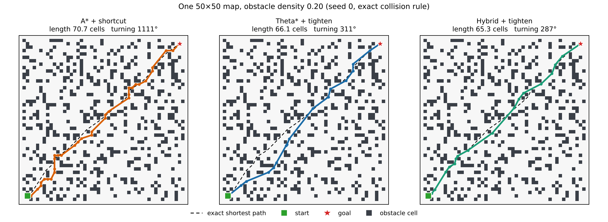
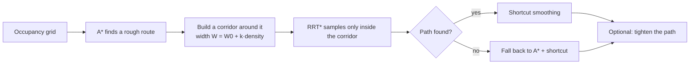
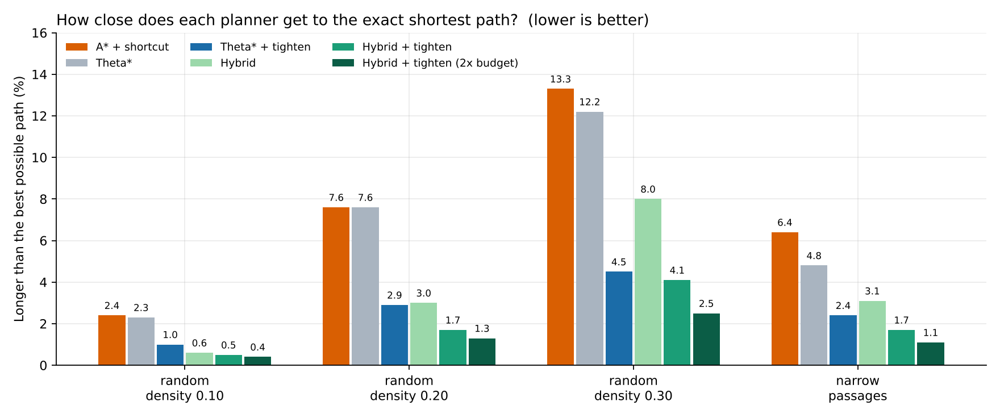
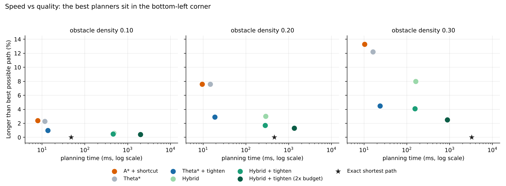
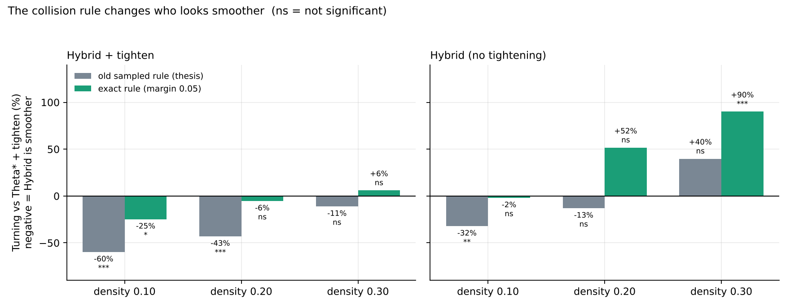
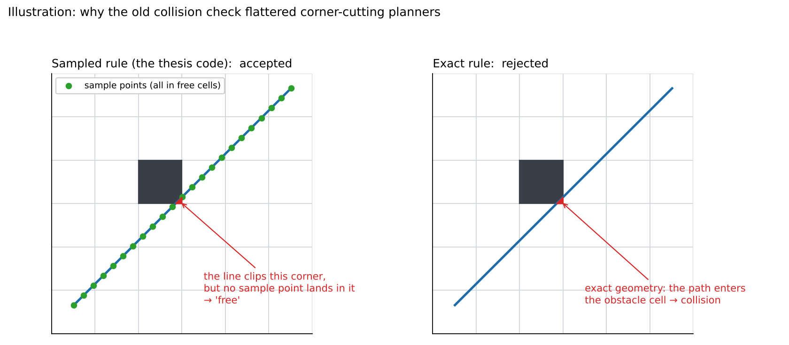
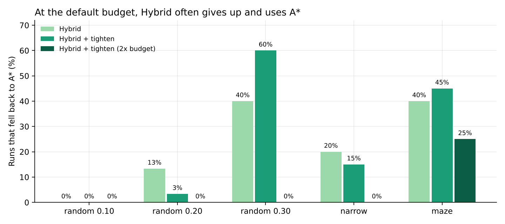
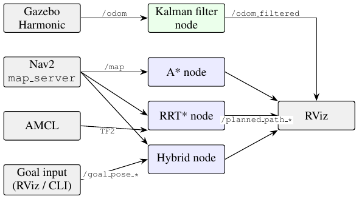

<p align="center">
  
</p>

<h1 align="center">A*-seeded corridor RRT* — and an honest benchmark of when it wins</h1>

<p align="center">
  <a href="https://github.com/Asif-Ucchwas/hybrid-a-star-rrtstar-path-planning/actions/workflows/ci.yml"></a>
  
  
  
  
</p>

> [!NOTE]
> This repository began as a master's thesis (Lamar University, May 2026) that proposed an **A\*-seeded
> adaptive-corridor RRT\***. Re-testing it against stronger baselines, with a stricter collision check,
> changed the conclusion. This README tells the **current, honest version**. The original thesis state is
> kept as the git tag `v1.0-thesis` and in [`docs/THESIS_README.md`](docs/THESIS_README.md).

<p align="center">
  <b>1,340</b> planner runs &nbsp;·&nbsp; <b>130</b> maps &nbsp;·&nbsp; <b>7</b> planners &nbsp;·&nbsp; <b>2</b> collision rules &nbsp;·&nbsp; every run seeded &nbsp;·&nbsp; <a href="results/RUN_LOG.md">run log</a> &nbsp;·&nbsp; <a href="docs/DEVLOG.md">dev log</a>
</p>

---

## 🔎 The 30-second version

| | What we found | Numbers |
|---|---|---|
| ✅ | **Hybrid beats A\* with random shortcut smoothing** | 1.7–4.7% shorter, 36–61% less turning |
| ⚖️ | **…but a cheap Theta\* + "pull it tight" step almost matches it** | only 0.4–1.2% shorter; smoother only on the emptiest maps |
| 🐢 | **Hybrid costs much more time** | 6.5–33.7× the planning time of Theta\* + tighten |
| 🚫 | **At default settings it often gives up and falls back to A\*** | 40–60% of runs on the densest maps |
| 🧪 | **The old collision check flattered corner-cutting planners** | 73–100% of old-rule paths clipped an obstacle |
| 🎯 | **Tightened planners are already close to the best possible path** | within 4.5% of the exact shortest path |

**So:** the corridor idea works, but it is *not* a clear win over simple, well-known baselines on these maps.
The repository is now best used as a **reproducible benchmark** — 15 planner variants, seeded maps, an exact
collision checker and an exact shortest-path reference — plus the thesis planner as one entry in it.

---

## 🗺️ One map, three planners

<p align="center">
  
</p>

A typical map (the seed with the median length difference between the two tightened planners, not a hand-picked one).
Orange wanders; blue and green hug the dashed *exact shortest path*. Reproduce it with
`python scripts/make_map_figure.py --seed 0`.

---

## 🧩 How the thesis planner works



**Why try it?** A* is fast and reliable but angular. RRT\* is smooth but wanders in clutter. Confining RRT\*
to a corridor around the A\* route was meant to keep both strengths.

---

## 📊 Scoreboard — random maps, density 0.20

*50×50 grid, 30 maps (29 solvable under the exact rule), exact collision rule. Lower is better in every column.
"Above best" is how much longer the path is than the exact shortest path; one block ≈ 0.5%.*

| Planner | Path length | Above best | Turning | Time | |
|---|---:|---:|---:|---:|---|
| A* + shortcut | 70.4 | +7.6% | 743° | 10 ms | `███████████████` |
| Theta* | 70.4 | +7.6% | 654° | 15 ms | `███████████████` |
| Theta* + tighten | 67.3 | +2.9% | 251° | 19 ms | `██████` |
| Hybrid | 67.4 | +3.0% | 380° | 292 ms | `██████` |
| Hybrid + tighten | 66.5 | +1.7% | 237° | 282 ms | `███` |
| Hybrid + tighten (2x budget) | 66.3 | +1.3% | 244° | 1.4 s | `███` |
| Exact shortest path | 65.5 | — | 211° | 458 ms | `▏` |

<details>
<summary><b>Density 0.10 (sparse)</b></summary>

| Planner | Path length | Above best | Turning | Time | |
|---|---:|---:|---:|---:|---|
| A* + shortcut | 65.5 | +2.4% | 204° | 8 ms | `█████` |
| Theta* | 65.5 | +2.3% | 194° | 12 ms | `█████` |
| Theta* + tighten | 64.6 | +1.0% | 81° | 14 ms | `██` |
| Hybrid | 64.3 | +0.6% | 79° | 478 ms | `█` |
| Hybrid + tighten | 64.3 | +0.5% | 61° | 458 ms | `█` |
| Hybrid + tighten (2x budget) | 64.2 | +0.4% | 66° | 2.0 s | `█` |
| Exact shortest path | 64.0 | — | 66° | 48 ms | `▏` |

</details>

<details>
<summary><b>Density 0.30 (cluttered)</b></summary>

| Planner | Path length | Above best | Turning | Time | |
|---|---:|---:|---:|---:|---|
| A* + shortcut | 80.7 | +13.3% | 1424° | 10 ms | `███████████████████████████` |
| Theta* | 79.9 | +12.2% | 1130° | 16 ms | `████████████████████████` |
| Theta* + tighten | 74.4 | +4.5% | 476° | 24 ms | `█████████` |
| Hybrid | 76.9 | +8.0% | 905° | 160 ms | `████████████████` |
| Hybrid + tighten | 74.1 | +4.1% | 505° | 154 ms | `████████` |
| Hybrid + tighten (2x budget) | 73.0 | +2.5% | 466° | 889 ms | `█████` |
| Exact shortest path | 71.2 | — | 449° | 3.3 s | `▏` |

</details>

**Reading the columns.** *Turning* is the total of all heading changes along the path in degrees: a straight line
is 0°, a zig-zag is large, so lower means smoother. Times were measured on one machine
(Intel Core Ultra 7 265K, Python 3.12.3, one worker, idle) and describe this Python code, not the algorithms.

---

## 📈 What the data says

### 1. Tightened planners are close to the shortest path; untightened A\* and Theta\* are not

<p align="center"></p>

Tightened Theta\* and tightened Hybrid are within 4.5% of the best possible length.
There is little room left for any sampling-based refinement on these maps.

### 2. Hybrid pays a lot of time for a small gain

<p align="center"></p>

Bottom-left is best. Theta\* + tighten (blue) sits far to the left of every Hybrid variant, at nearly the same
height as Hybrid + tighten. Giving Hybrid twice the budget (dark green) buys 0.6–1.9% in length at 38–147×
the time of Theta\* + tighten.

### 3. The collision rule changed who looks smoother

<p align="center"></p>

Under the old *sampled* rule, Hybrid + tighten looks 60% / 43% smoother than
Theta\* + tighten at densities 0.10 / 0.20. Under the *exact* rule the gap is 25% at 0.10 and
not significant at the other densities. `ns` means the difference could be noise.

<p align="center"></p>

The thesis code checked each segment at a few sample points. A path can clip an obstacle corner *between*
two samples and still pass. Planners that cut corners aggressively gained most from that. The exact rule
(with a 0.05-cell safety margin) closes the loophole for every planner equally. *(The picture is an
illustration, not measured data.)*

### 4. At default settings Hybrid often gives up

<p align="center"></p>

When the corridor RRT\* finds no path within its iteration and node limits, the planner falls back to
A\* + shortcut smoothing. On dense and maze maps that happens a lot, so the default Hybrid numbers there partly
describe A\* paths. Doubling the budget removes the fallbacks on random and narrow maps.

---

## ⚠️ Limits

> [!IMPORTANT]
> **Limits.** 50×50 grids; 20–30 maps per scenario; one safety margin (0.05 cell); Hybrid's default
> settings were tuned under the old collision rule and not re-tuned; timings are Python on one machine; the
> sampled-rule control covers only random maps. Read the differences as screening evidence and the
> magnitudes as the finding.

---

## 🚀 Reproduce everything

```bash
git clone https://github.com/Asif-Ucchwas/hybrid-a-star-rrtstar-path-planning.git
cd hybrid-a-star-rrtstar-path-planning
pip install -r requirements-dev.txt
python -m pytest -q                                   # unit tests

# the two runs behind every number above (single worker = clean timing)
python -m benchmarks.runner configs/decision.json --workers 1          # exact rule, 890 runs
python -m benchmarks.runner configs/decision_control.json --workers 1  # old sampled rule, 450 runs
python -m benchmarks.analyze results/decision --ref theta_star_tight
python -m benchmarks.analyze results/decision --ref vis_graph          # overwrites summary.md: copy it first

# the charts in this README (read from results/summaries/)
python scripts/make_readme_figures.py
python scripts/make_map_figure.py --seed 0
```

Runs are seeded per (scenario, map, planner), so a rerun gives identical paths. The summaries behind the charts
are committed in [`results/summaries/`](results/summaries/). A one-minute smoke run:
`python -m benchmarks.runner configs/smoke.json --out results/smoke`.

<details>
<summary><b>All planners in the benchmark</b></summary>

| id | planner |
|---|---|
| `astar`, `astar_smooth`, `astar_tight` | 8-connected A\*, + random shortcuts, + deterministic tightening |
| `theta_star`, `theta_star_cc`, `theta_star_smooth`, `theta_star_tight` | Theta\* variants (`_cc` uses A\*'s movement rules) |
| `hybrid`, `hybrid_fallback`, `hybrid_tight` | the thesis planner, + A\* fallback, + tightening |
| `vis_graph` | exact shortest path through obstacle corners (a length reference) |
| `rrt_star`, `informed_rrt_star`, `rrt_connect`, `bit_star` | sampling-based baselines |
| `ompl_*` | OMPL reference implementations (optional install) |

Details, metrics and statistics: [`benchmarks/README.md`](benchmarks/README.md).
</details>

---

## 📁 What's where

```
planner_core/      the thesis planner (A* + corridor + RRT*) and shared geometry / collision code
baselines/         A*, Theta*, tightening, exact shortest path (visibility graph), BIT*, OMPL adapters
benchmarks/        map generators, runner, metrics, statistics
configs/           the experiment definitions (decision.json is the one behind this README)
results/summaries/ the committed result tables and CSV behind the charts
assets/readme/     the charts above (regenerated by scripts/)
ros2_integration/  standalone ROS2 nodes for A*, RRT* and Hybrid, plus a Kalman filter node
src/               thin compatibility wrappers plus the original thesis scripts (demo, 50-trial benchmark)
paper_figures/     the original thesis figures
docs/              architecture notes and the archived thesis README
```

---

## 🤖 ROS2 deployment (status)

The three thesis planners run as independent ROS2 nodes against the `nav2_bringup` TurtleBot3 simulation,
using a live `OccupancyGrid` and AMCL localization (ROS2 Jazzy, Gazebo Harmonic, Ubuntu 24.04). They are
**standalone nodes, not yet a Nav2 planner plugin**, and the Kalman-filter node was validated on synthetic
data only. A Nav2 plugin and hardware tests on a Rover Robotics MEGA are the planned next step.
See [`ros2_integration/planner_nodes/`](ros2_integration/planner_nodes/).



---

## 📚 Thesis, history and citation

- **Thesis:** *Obstacle Avoidance and Optimal Path Planning for Autonomous Mobile Robots Using Sampling-Based and
  Graph-Based Algorithms*, M.E.S., Lamar University, 2026 — [ProQuest](https://www.proquest.com/dissertations-theses/obstacle-avoidance-optimal-path-planning/docview/32699575).
- **Original repo state:** git tag `v1.0-thesis` and [`docs/THESIS_README.md`](docs/THESIS_README.md).
  Its headline numbers (RRT\* 60%, Hybrid 98%, −5.87% vs RRT\*) came from the thesis benchmark and are not
  what the stronger re-evaluation above supports.
- **Write-up:** a short technical report on the collision-rule finding is in preparation (research in progress).
- **Cite:** see [`CITATION.cff`](CITATION.cff).

## 👤 About

**Md Asifuzzaman** — M.E.S. Electrical Engineering, Lamar University. Interested in robot planning and autonomy.
[LinkedIn](https://linkedin.com/in/masifuzzaman) · [GitHub](https://github.com/Asif-Ucchwas) · asifuzzamanucchwas@gmail.com

Also: IoT-based fault detection system (co-authored, IJSRP, July 2023); smartphone-controlled mobile robot
(3rd place, national robotics competition).
